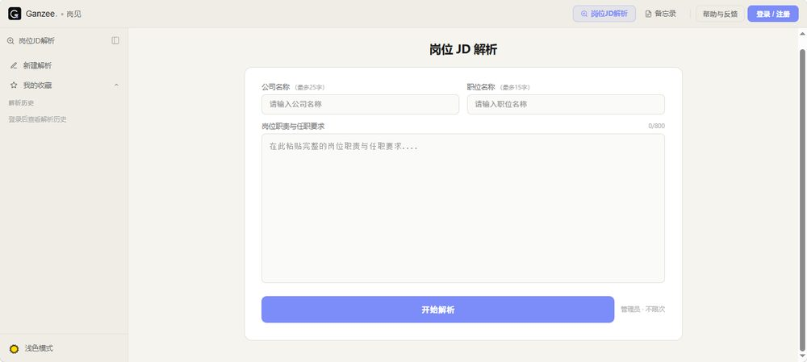
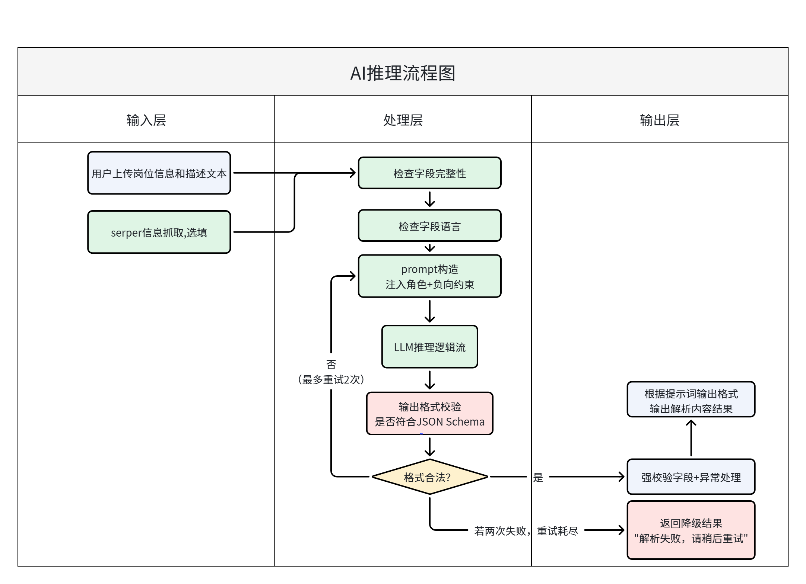

# 岗见 · AI Job Description Analyzer

> 面向求职者的 JD 解析手机 Web 应用：一次解析同时完成「JD 解读 + 公司背景核查 + 岗位真实性提示」。

**在线体验：** https://www.ganzee.top ｜ **角色：** 产品设计 + 独立开发 ｜ **技术：** React · TypeScript · Vite · Supabase（Auth / Postgres / Edge Functions）· DeepSeek · Serper

## 01 要解决的问题
求职者筛选岗位时的三类噪音：
1. **JD 难读**：术语密集、条目繁杂甚至全英文，岗位名称不能直接反映真实业务方向。
2. **公司难查**：官网、工商信息、招聘平台评价分散在不同平台，逐个核查成本高。
3. **低质岗位难识别**：僵尸岗位、标题未注明的外包 / 驻场岗位、以产品经理名义招募投资人或合伙人的虚假岗位。

## 02 产品设计
**形态：** 手机端 Web 应用；文本 / 图片录入 JD，记录公司与岗位，展示解析结果。

**核心功能：** 全中文输出 · 异常识别 · 岗位分类（岗位名称-细分类型）· 术语大白话解析（重点是「企业真实需求」）· 公司官网信息检索 · 复制 / 重新生成 · 点赞点踩反馈 · 解析历史 · 个人备忘录（公司 / 岗位 / JD 解析 / 面试情况 / 个人记录）。

**产品边界：** AI 只做判断的基础工作，最终决策由用户自己做。

**账号：** 手机号验证码登录（首次自动注册）。未登录可解析但不保存；登录后数据存入个人账户，历史可回溯、可删除、账号间隔离；点击需登录的功能时弹出引导。

| V1 做 | V1 暂不做 |
|---|---|
| JD 录入与解析、异常识别、岗位分类 | 招聘平台评价抓取 |
| 公司官网信息检索与交叉验证 | 天眼查数据查询 |
| 历史、备忘录、反馈 | 简历匹配度分析、多 JD 横向比较、offer 概率预测 |

**迭代规划：** V2 面试日历提醒、面试复盘可视化、我的收藏；V3 图片存储、录音转文字。

产品流程：用户业务主流程与系统流程见 [docs/flows.md](docs/flows.md)；AI 推理流程见下方「03 AI 设计」。

## 03 AI 设计
**推理管线（5 个逻辑节点）：** 校验输入字段并识别语言 → 非中文则翻译 → 大白话解读真实需求 → 岗位分类 + 虚假岗位判别 + 公司信息整合 → 按 JSON Schema 输出。

**AI 推理流程：** 输入层接收岗位信息与描述文本（公司信息检索为选填）；处理层依次做字段完整性与语言检查、构造 Prompt（注入角色与负向约束）、调用模型，并对输出做 JSON Schema 校验——不合法则带约束重试（最多 2 次），仍失败则返回降级结果「解析失败，请稍后重试」。

**输出契约：** `title` · `category`（岗位名称-细分类型，≤15 字）· `risk_alerts`（无风险返回 `["无"]`，不得为空数组）· `insight`（50–150 字）· `company_brief`（≤100 字，必须基于检索结果）· `analysis_status`。强校验字段出错自动重试，最多 2 次。

**Prompt 结构：** Role / Context / Task / Input / Constraints / Negative Constraints / Output Format，另配正向与边缘案例的 few-shot；规则层级 System Rules → System Prompt → Developer Prompt → User Prompt。

**风险识别：** 以触发词族为基础（身份类、诱导类、待遇类），再叠加「JD 文本 × 公司公开信息」的交叉验证，例如公司主营含外包而 JD 未写明时，强制提示用工风险。

**模型选型：** 在 Kimi、GPT、Claude、DeepSeek 之间按能力 / 成本 / 延迟 / 限制对比，选用 DeepSeek（中文语境表现好、成本低、兼容 OpenAI 协议便于替换）；已知局限是海外部署时国内 API 访问可能不稳定。

**稳定性设计：** 同步调用、前端逐字渲染；无状态单次调用，不累积历史。文档中定义了三级超时与 429 指数退避重试；V1 线上实现为：输入校验 → 限流 → 模型调用 → JSON 与字段校验，失败时返回错误并退回游客次数。

**成功标准（设计目标，非实测结果）：** JSON 解析成功率 ≥ 90%，字段完整率 ≥ 95%，响应时间 P50 ≤ 35 秒、P95 ≤ 55 秒。

**评估方法：** 从招聘平台按岗位类型、风险程度、JD 质量三个维度分层抽样 50–70 条作评测集；先定义 Bad Case（输出与 JD 不符、字段缺失、类型误判、乱码、洞察空泛），再设定触发 Prompt 修改的阈值（如 JSON 失败率 > 2%、Bad Case 率 > 10%、出现 1 例诱导造假或歧视性输出即零容忍）。

**对模型常见问题的预判：** 需求阶段就梳理了逻辑篡改、权重分配错误、推理失败三类问题，并以真实对话案例复盘，用来指导后续 Badcase 分类。

### Prompt 迭代（Badcase 驱动）
| 版本 | 触发问题 | 改动 |
|---|---|---|
| V1.0 | 无风险时返回空数组，前端崩溃 | 约定无风险返回 `["无"]`，严禁空数组 |
| V1.1 | 洞察只有二三十字，无信息量 | 限定 50–150 字 |
| V2.0 | 输入虚构公司「阿里嘎多」，返回了阿里巴巴的信息 | 新增公司名匹配规则，不符则输出固定文案 |
| V2.1 | 外包公司 JD 不写外包，但搜索结果能查到 | 新增外包交叉验证，命中关键词强制加风险提示 |

详见 [docs/prompt-iteration.md](docs/prompt-iteration.md)（不含 Prompt 原文）。

## 04 技术方案
| 层 | 方案 |
|---|---|
| 前端 | React + TypeScript + Vite，Vercel 托管与自动部署 |
| 后端 | Supabase Edge Function（`analyze-jd`），密钥只存在服务端 |
| 数据 | Supabase PostgreSQL；解析历史、备忘录、用户信息三张表，RLS 行级安全按账号隔离 |
| 认证 | Supabase Auth（JWT，1 小时 access token + refresh token 续期） |
| 大模型 / 检索 | DeepSeek · Serper |
| 限流（已实现） | 游客每日 3 次（设备维度原子扣减，失败自动退回），登录用户每日 5 次，注册当天可叠加游客次数 |
| 数据生命周期 | 解析历史保留 30 天；备忘录软删除；`ai_logs` 仅存输入前 800 字用于排查 |
| 错误处理 | 统一错误码（缺字段 / 未登录 / 限流 / AI 失败 / 检索失败 / 数据库失败 / 超时），检索失败时跳过公司检索继续解析，入库失败时结果照常展示 |
| 监控 | `ai_logs` 表记录每次调用，SQL 统计成功率、延迟、风险检出率；风险检出率 ≠ 准确率，准确率需人工抽样 |

调用链路：`前端 → Edge Function → Serper 检索 + LLM 解析 → JSON 返回 → 前端判断登录状态 → 已登录则写入数据库`。

## 05 已知局限与后续
- 英文 JD 识别准确率偏低
- 公司过于冷门、搜索无结果时，退化为纯 JD 分析
- 评测集与准确率复核仍在持续补充
- 规划：招聘平台评价、简历匹配（V1 范围外）、V2 / V3 功能

## 文档
[产品需求文档](docs/PRD.md) · [产品流程图](docs/flows.md) · [AI 推理规格](docs/ai-spec.md) · [系统架构](docs/architecture.md) · [Prompt 迭代](docs/prompt-iteration.md) · [运营与监控](docs/operations.md) · [代码节选](src/README.md)

## 说明
本仓库为项目展示，不含密钥、真实用户数据与完整 Prompt 原文。代码仅供展示，未经许可不得复制商用。
