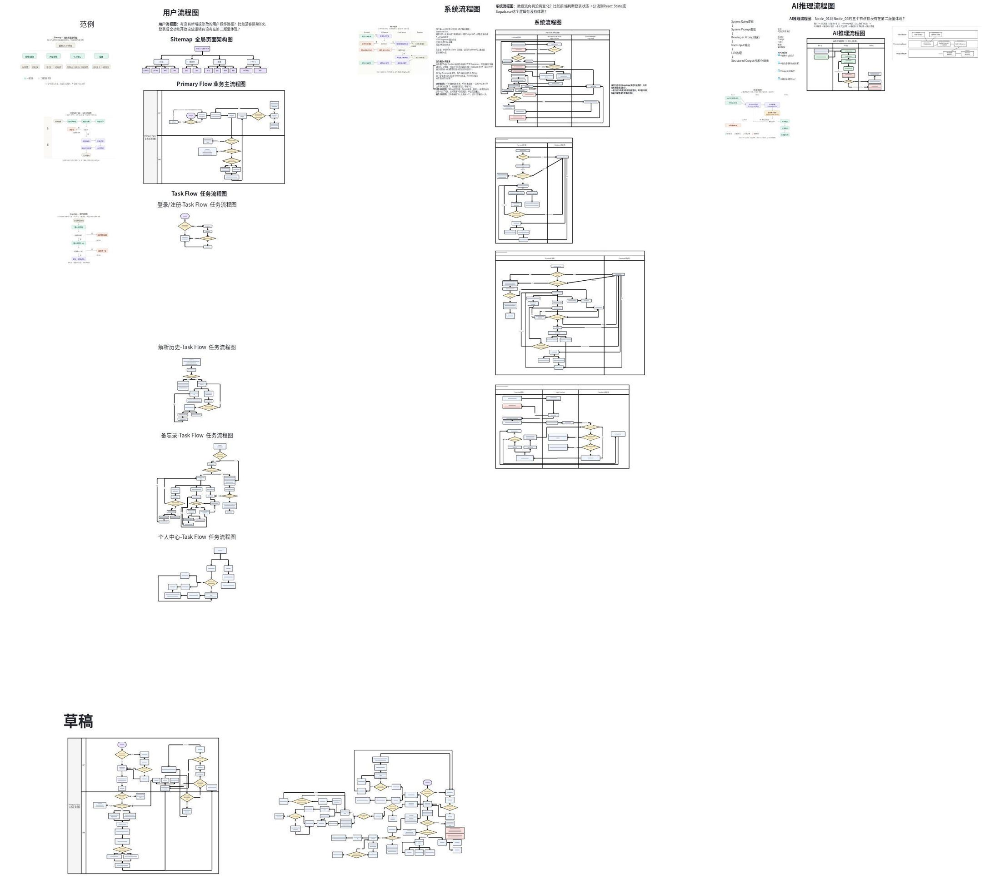
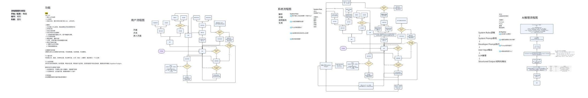
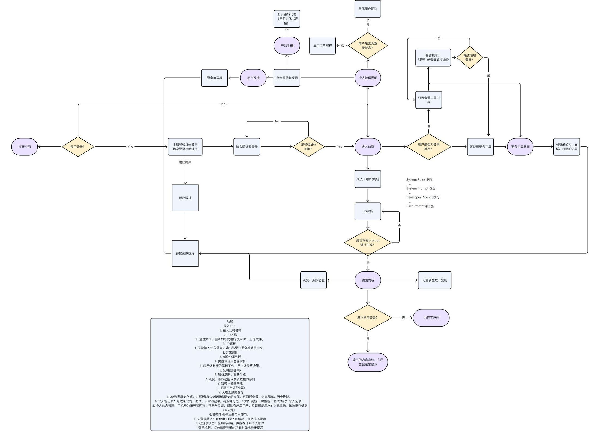

# 岗见 · 产品需求文档（PRD）

## 1. 项目背景

在现在经济下行时期，每年都有很多毕业生流入市场找工作，但应市场岗位的供不应求，求职难是现在年轻人的一个难题。求职市场里的岗位鱼龙混杂，求职者需要花大量的时间去分析和了解多个岗位，信息过于分散，这对求职者的精力和时间的消耗让求职者们非常痛苦。针对这个需求，开发了此项目，致力解决岗位分析相关的问题，提升求职者们的求职效率。

## 2. 项目简介

用于在手机上的web应用。支持文本、图片进行JD信息的上传，并支持记录公司以及相关岗位的信息，同时可展示当前JD信息的解析内容。

## 3. 需求来源

求职过程中，岗位筛选环节耗时耗力且存在较高的信息噪音，主要体现在以下几个维度：

**JD 内容解读困难** 部分 JD 描述模糊、术语密集、条目繁杂或全英文呈现，需要大量额外时间消化；岗位名称也无法直接反映实际业务类型（业务方向、平台属性、应用场景等），必须结合正文才能判断。

**公司背景核实成本高** 评估一家公司是否值得投递，需要跨平台操作：查官网了解主营业务，查天眼查核实工商信息（注册/实缴资本、社保缴纳、诉讼记录、合规状态），查招聘平台的员工/应聘者评价——信息分散，逐一核查耗费大量精力。

**低质岗位难以快速识别** 存在多类"陷阱型"岗位需要人工甄别：长期挂岗但 HR 长期不活跃的僵尸岗位；外包/外派/驻场岗位未在标题中注明；以产品经理等正规岗位名义实际招募投资人或合伙人的虚假岗位。

**核心诉求**：希望有一套工具或流程，能将 JD 解读、公司核查、岗位真实性判断整合在一起，降低单次筛选的时间与认知成本，让求职精力集中在真正值得投递的岗位上。

## 4. 功能清单-主要功能

- 录入JD：
  - 输入公司名称
  - JD名称
  - 通过文本、图片的形式进行录入JD，上传文件。
- JD解析:
  - 无论输入什么语言，输出结果必须全部使用中文
  - 异常识别
  - 岗位分类判断 (岗位名称-细分类型)
  - 岗位术语大白话解析,深度解析，重点在“企业真实需求”
    - 应用做判断的基础工作，用户做最终决策。
  - 公司官网抓取
  - 解析复制，重新生成
  - 点赞、点踩功能以及该数据的存储
  - 暂时不做的功能
    - 招聘平台评价抓取
    - 天眼查数据查询
- JD数据历史存储：对解析过的JD记录做历史的存储，可回溯查看，信息隔离，历史删除。
- 个人备忘录：可收录公司、面试、日常的文本记录。有五种可选，公司：岗位：JD解析：面试情况：个人记录：,模板输出（类似这种，例图1）
  - **V2扩展：**记录日期、面试闹钟提醒（连接手机/电脑的日历系统，有提醒功能）、面试记录总结可视化(例如通过失败比率、一周的面试耗时时长、一周的使用时间、一周的笔记输出条数报告、一周的使用次数等等）
  - "**V3扩展：图片存储（Supabase Storage）、录音转文字（待选语音识别API）**"

例图1

- 个人信息管理：手机号为账号和昵称；帮助与反馈，帮助有产品手册，反馈则是用户的信息收录，数据全部存储在 Supabase Postgres
- 使用手机号注册用户使用。
  - 未登录状态：可使用JD录入和解析，但数据不保存
  - 已登录状态：全功能可用，数据存储到个人账户
  - > 引导机制：点击需要登录的功能时弹出登录提示
- 我的收藏：对解析过的JD记录选取重点的记录收藏，可回溯查看，信息隔离，收藏移除、移入收藏。**（V2做）**

## 5. 流程图

- 用户流程图：**一张总览图 + 多张功能细节图**
- 系统流程图
- AI推理流程图

迭代草稿

