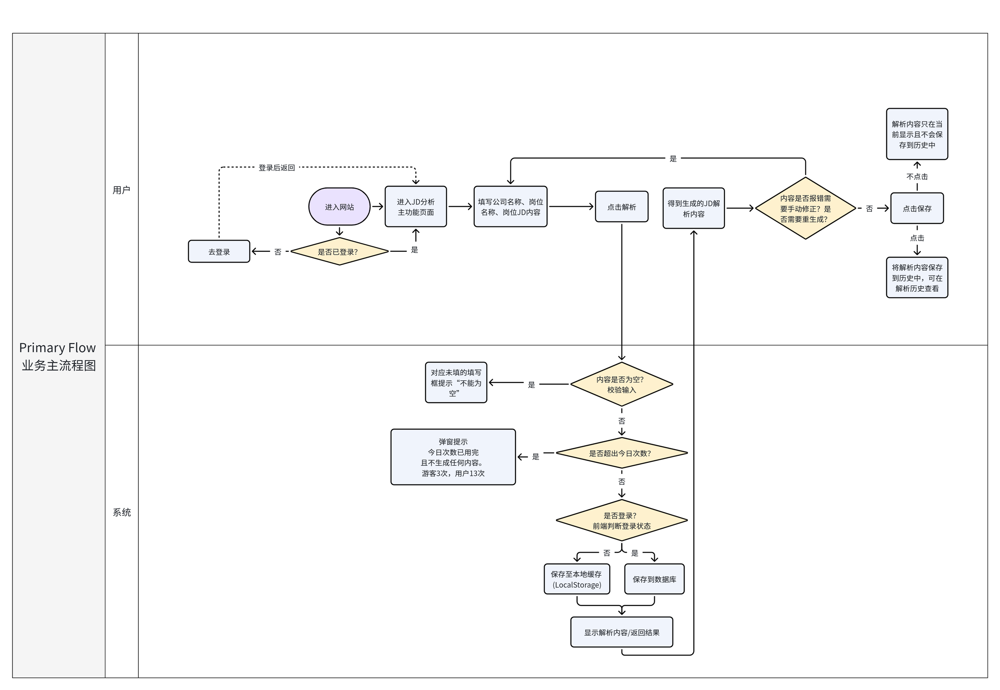
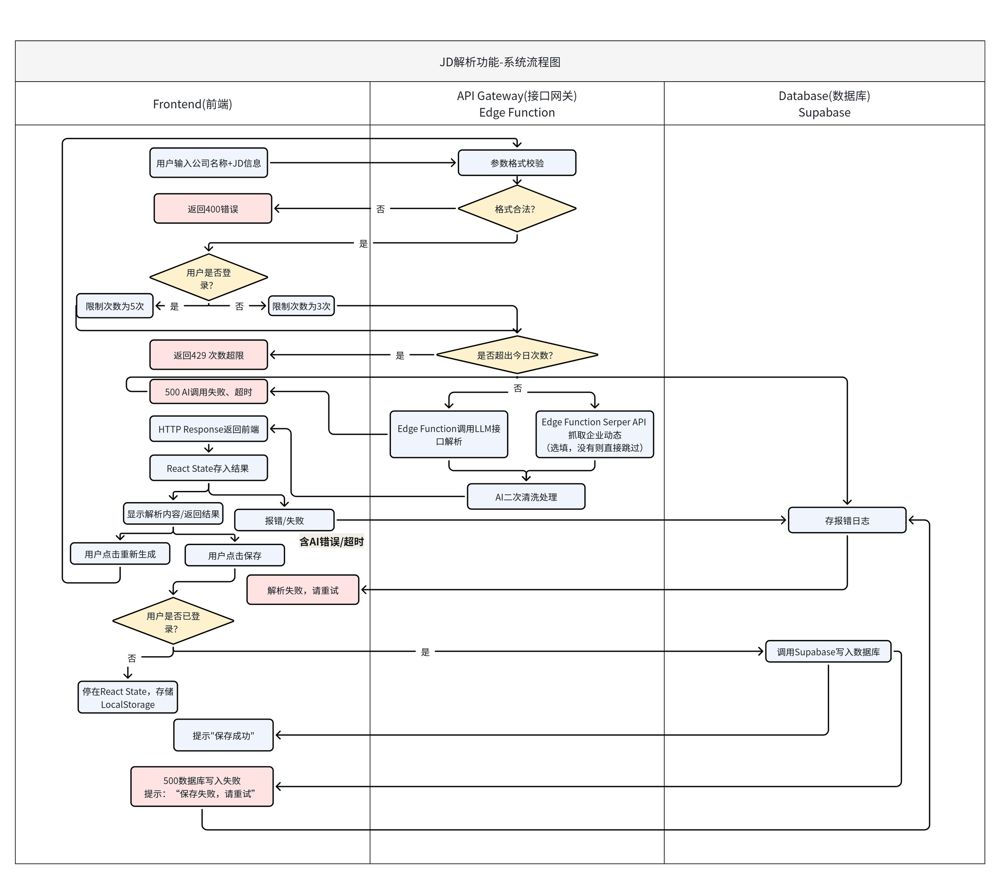
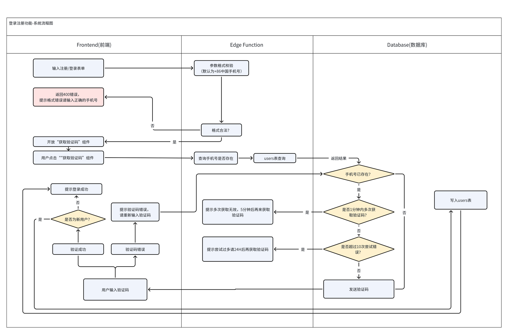
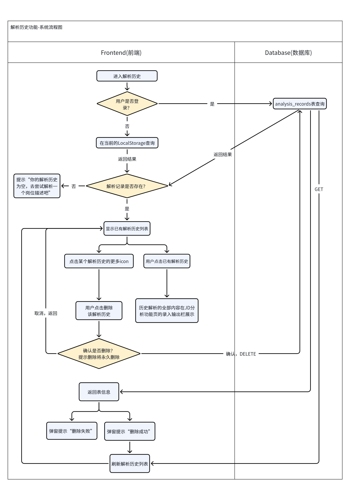
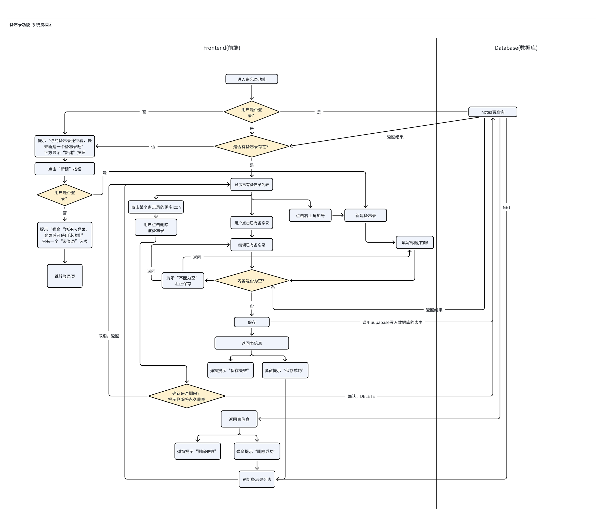
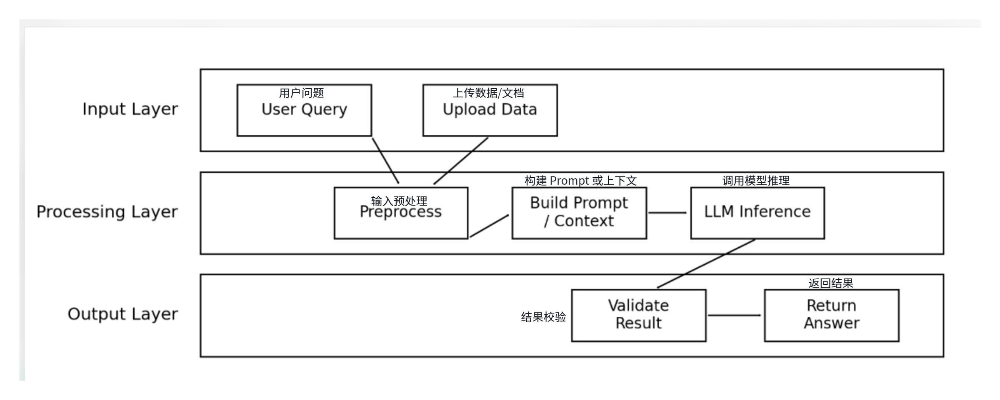

# 产品流程图

> 说明：次数限制以「游客 3 次 / 登录用户 5 次（与游客共享次数池）」为准，详见 [运营与监控](operations.md)。

## 业务主流程图（用户 / 系统）
从进入网站、登录判断、填写 JD、触发解析，到次数校验、结果展示、重新生成与保存的完整路径。

## JD 解析功能：系统流程图（前端 / 接口网关 / 数据库）
前端、Edge Function、Supabase 三层之间的调用关系，包括参数校验（400）、次数超限（429）、AI 调用失败或超时（500）与报错日志、数据库写入失败的处理分支。

## 其他功能：系统流程图

### 登录注册（前端 / Edge Function / 数据库）
手机号格式校验（默认 +86）、验证码发送限制（1 分钟内多次获取、累计 10 次错误后 24 小时内不可再获取）、新老用户判断与写入 users 表。

### 解析历史（前端 / 数据库）
登录用户读取 analysis_records 表，未登录用户读取 LocalStorage；支持查看历史、删除（二次确认，永久删除）与列表刷新。

### 备忘录（前端 / 数据库）
备忘录仅登录用户可用，未登录时只提供「去登录」入口；新建与编辑时校验内容不能为空，保存与删除后返回结果提示并刷新列表。

## AI 推理流程图
主图见 [README · 03 AI 设计](../README.md)，规格见 [AI 推理规格](ai-spec.md)。

### 内部处理机制（分层示意）

